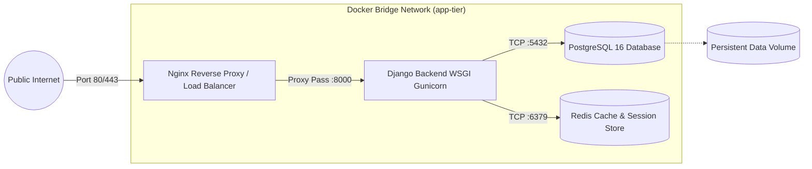
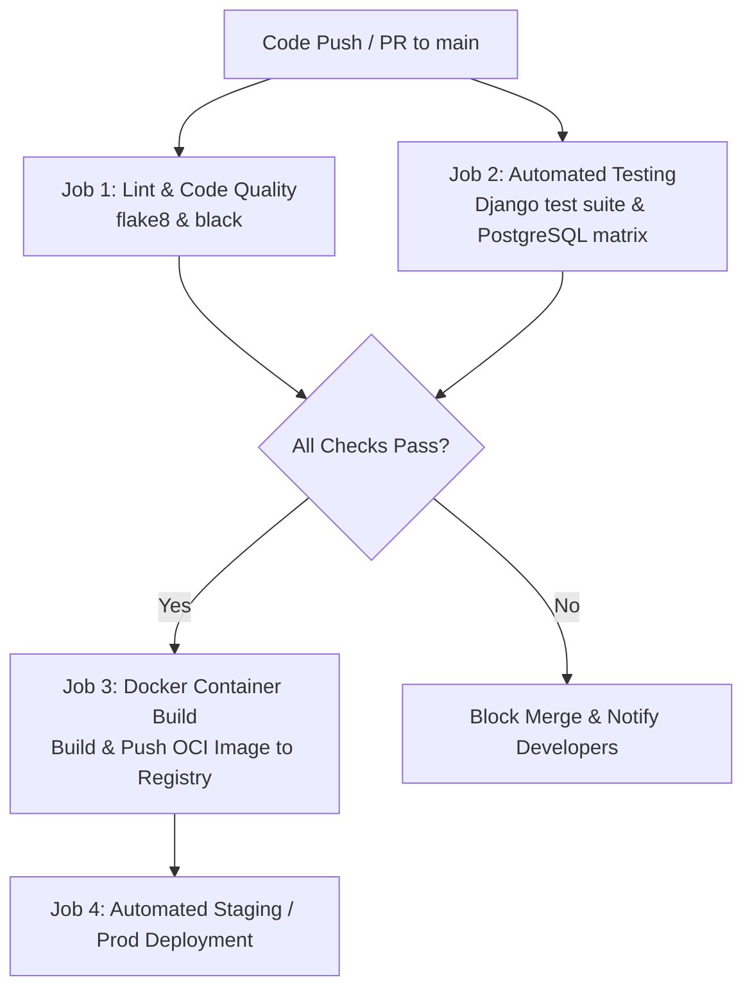

# DevOps & Deployment Operations Guide
## Real-Time Cycle Sharing & Booking Platform with Integrated Wallet
**Document Identifier:** OPS-CSB-2026-V1.0  
**Project Domain:** Software Development & Operations

---

### 1. Operations Overview

This document outlines the containerization, orchestration, continuous integration, and infrastructure provisioning procedures designed for the **Cycle Sharing & Booking Application**.

---

### 2. Infrastructure Architecture & Docker Orchestration

The application services are fully containerized using multi-stage Docker builds and orchestrated with Docker Compose:

#### Services Summary
1. **`backend`**: Python 3.12 / Django WSGI application executed under Gunicorn with 3 worker processes.
2. **`db`**: PostgreSQL 16 Alpine container with healthchecks and persistent volume mount (`pg_data`).
3. **`redis`**: In-memory caching and real-time state store.
4. **`nginx`**: Edge gateway serving static/media files, handling SSL termination, and reverse proxying requests.

---

### 3. Continuous Integration & Continuous Delivery (CI/CD)

The GitHub Actions workflow (`.github/workflows/ci-cd.yml`) executes automated quality gates on every Pull Request and merge to `main`:

#### Pipeline Steps:
- **Linting & Code Quality**: Syntax verification, PEP8 compliance, dependency security scanning.
- **Unit & Integration Tests**: Runs tests with automated PostgreSQL database provisioning.
- **Docker Image Build**: Compiles slim production Docker image tagged with Git commit SHA.

---

### 4. Production Deployment Checklist
1. Generate high-entropy `SECRET_KEY` and store in secure secrets vault (e.g., AWS Secrets Manager, GitHub Secrets).
2. Set `DEBUG=False` and configure `ALLOWED_HOSTS` to verified domain names.
3. Apply database migrations: `python manage.py migrate --noinput`.
4. Collect static files: `python manage.py collectstatic --noinput`.
5. Run automated database backups cron job.
