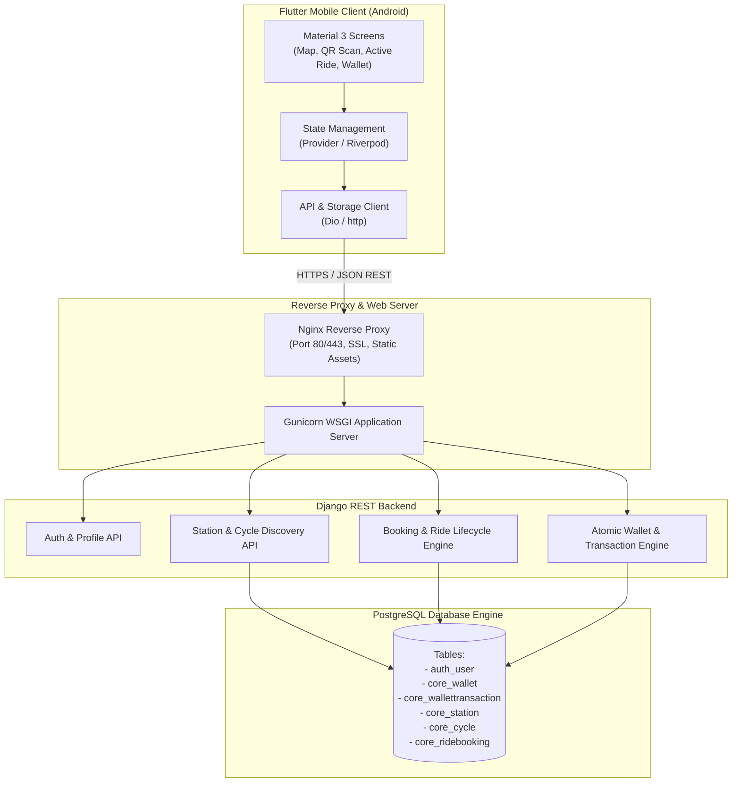
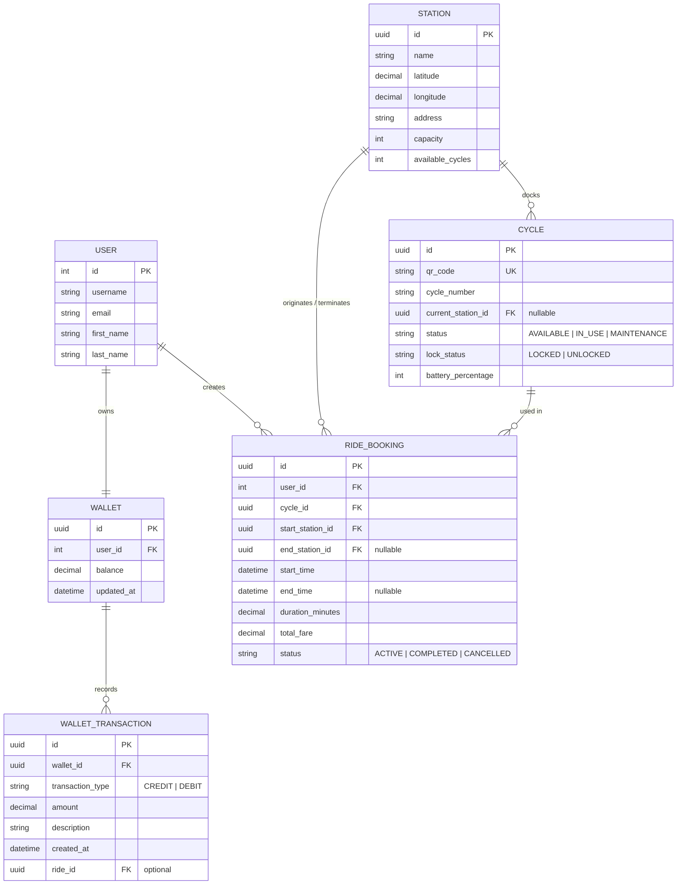
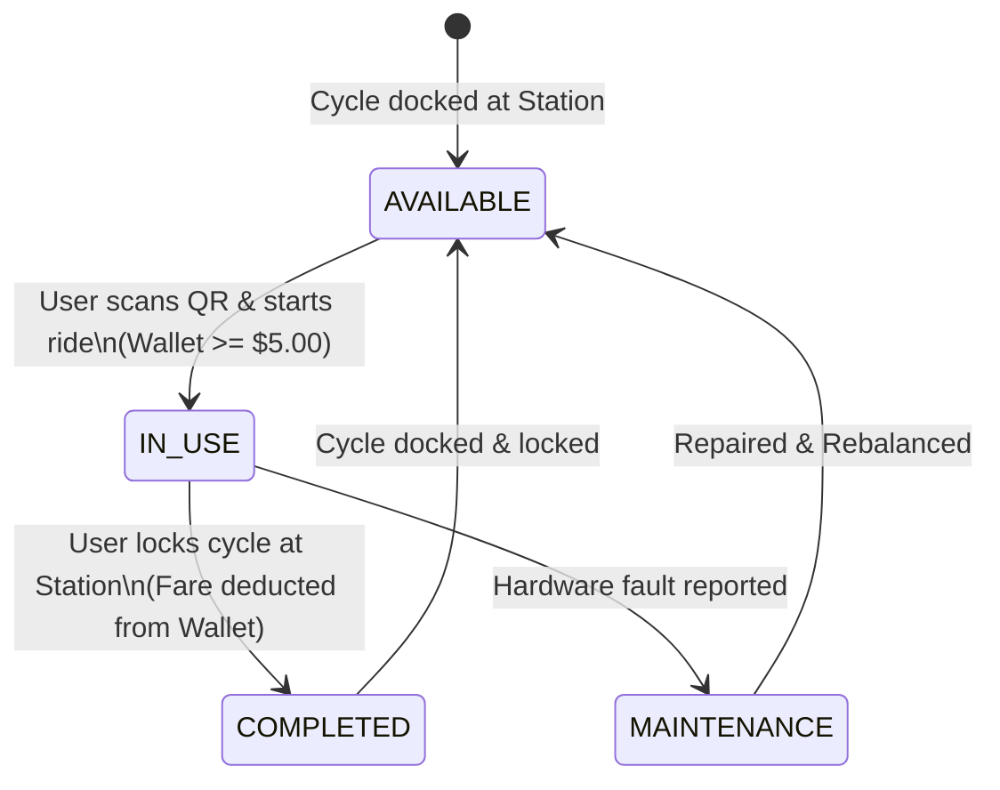
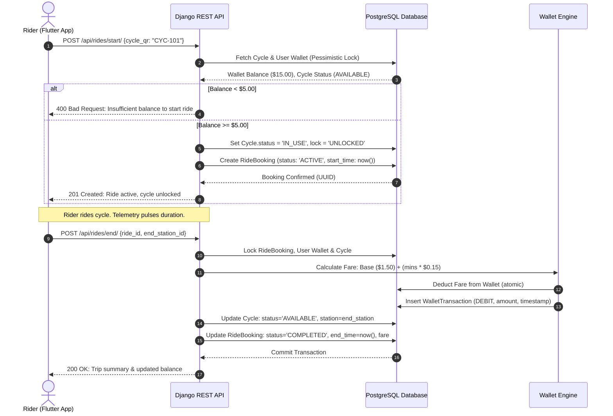

# System Architecture & Design Document
## Real-Time Cycle Sharing & Booking Platform with Integrated Wallet
**Document Identifier:** SDD-CSB-2026-V1.0  
**Project Domain:** Software Development & Operations

---

### 1. System Architecture Overview

The system is built on a 3-tier distributed microservices pattern:
1. **Presentation Tier (Client)**: Flutter Cross-Platform Client (Android focus) with Material Design 3, Provider state management, and HTTP API integration.
2. **Application Tier (Backend)**: Django 5 / 6 with Django REST Framework (DRF) handling business logic, authentication, ride state machine, and atomic wallet transactions.
3. **Persistence Tier (Database)**: PostgreSQL (or SQLite in local dev) maintaining transactional relational integrity with ACID guarantees.

---

### 2. Entity-Relationship (ER) Diagram

---

### 3. Ride Lifecycle State Machine

---

### 4. Sequence Diagram: Booking & Wallet Deduction Flow

